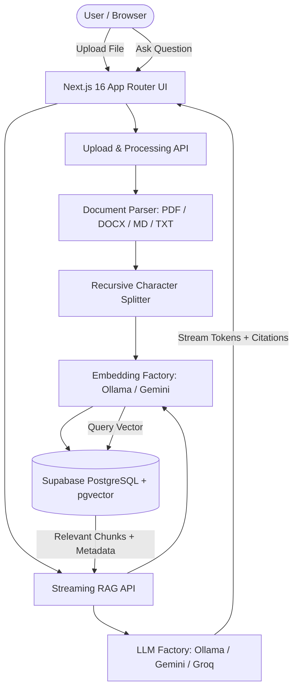

# KnowFlow AI ⚡ Turn Your Knowledge into Instant Answers

A production-grade, portfolio-ready AI SaaS platform that enables teams to upload enterprise documents, create isolated knowledge bases, and ask questions answered by LLMs through Retrieval-Augmented Generation (RAG) with verifiable citations and source grounding.

---

## 🌟 Highlights

- **Multi-Provider AI Engine (LangChain.js Orchestrated)**:
  - **Local-first with Ollama** (`llama3`, `mxbai-embed-large` / `nomic-embed-text`) — zero API cost and 100% offline privacy.
  - **Google Gemini** (`gemini-1.5-flash` + `text-embedding-004`) — high-speed, generous free-tier cloud option.
  - **Groq** (`llama-3.3-70b-versatile` / `mixtral-8x7b-32768`) — ultra-low-latency LPUs.
- **Enterprise RAG Pipeline**:
  - Vector similarity search powered by **Supabase PostgreSQL & `pgvector`** with HNSW indexing.
  - Multi-format ingestion: **PDF** (page-aware text extraction), **DOCX** (via Mammoth), **Markdown**, and **Plain Text**.
  - Intelligent chunking (500 tokens with 100-token overlaps) preserving document section headers and page metadata.
  - Honest grounding: Refuses hallucination when retrieval cosine similarity falls below safety threshold.
- **Modern Streaming UI**:
  - Server-Sent Events (SSE) streaming answers in real-time.
  - Interactive source citation cards displaying document name, page number, similarity score, and excerpt.
  - Multi-workspace switcher and usage analytics dashboard.
- **Inclusive Accessibility (WCAG 2.2 AA)**:
  - Multi-modal state cues (icons + text + color coding), full keyboard navigation (`Tab`, `Escape`, arrow keys), ARIA live announcements, and high-contrast color palette.
- **Strict Full-Stack Quality**:
  - 100% TypeScript strict mode.
  - Unit and component tests with **Vitest** and **React Testing Library**.
  - Production-ready builds verified on **Next.js 16 (Turbopack)**.

---

## 🏗️ Architecture



---

## 🛠️ Technology Stack

| Layer | Technology |
|---|---|
| **Framework** | Next.js 16 (App Router, Turbopack) |
| **Language** | TypeScript (Strict Mode) |
| **Styling** | Tailwind CSS v4, Lucide Icons |
| **UI Components** | Accessible Radix UI Primitives, Sonner (Toasts) |
| **Forms & Validation** | React Hook Form, Zod |
| **RAG & Orchestration** | LangChain.js (`@langchain/core`, `@langchain/textsplitters`) |
| **Vector Database** | Supabase PostgreSQL with `pgvector` extension |
| **Document Parsing** | `pdf-parse`, `mammoth` |
| **Testing** | Vitest, React Testing Library, JSDOM |

---

## 🚀 Quickstart Guide

### 1. Clone & Install Dependencies

```bash
git clone https://github.com/your-username/knowflow-ai.git
cd knowflow-ai
npm install --legacy-peer-deps
```

### 2. Environment Variables

Copy the provided example file:

```bash
cp .env.example .env.local
```

Fill in your configuration:

```env
# AI Provider (ollama | gemini | groq)
AI_PROVIDER=gemini
AI_MODEL_NAME=gemini-1.5-flash
EMBEDDING_PROVIDER=gemini
EMBEDDING_MODEL_NAME=text-embedding-004

# Keys (free tiers available)
GOOGLE_API_KEY=your_google_ai_studio_key
GROQ_API_KEY=your_groq_api_key

# Ollama (Local)
OLLAMA_BASE_URL=http://localhost:11434

# Supabase (Database & pgvector)
NEXT_PUBLIC_SUPABASE_URL=https://your-project.supabase.co
NEXT_PUBLIC_SUPABASE_ANON_KEY=your_anon_key
SUPABASE_SERVICE_ROLE_KEY=your_service_role_key
```

### 3. Database Migration

Run the SQL migration in `supabase/migrations/20250101000000_knowflow_init.sql` inside your Supabase SQL Editor. This sets up:
- `workspaces`, `documents`, and `document_chunks` tables
- `pgvector` extension with 768-dimension embeddings
- Match function `match_document_chunks` for fast cosine similarity retrieval
- Row Level Security (RLS) policies

### 4. Run Development Server

```bash
npm run dev
```

Open [http://localhost:3000](http://localhost:3000) to access KnowFlow AI.

### 5. Run Automated Tests

```bash
npm test
```

---

## 📂 Project Structure

```text
knowflow-ai/
├── app/
│   ├── api/
│   │   ├── analytics/        # Workspace statistics & chunk telemetry
│   │   ├── chat/             # SSE streaming RAG endpoint
│   │   ├── documents/        # Document CRUD & status checks
│   │   ├── documents/upload/ # Multi-format document parser & indexer
│   │   └── workspaces/       # Workspace isolation management
│   ├── analytics/            # Analytics dashboard
│   ├── chat/                 # Real-time Q&A interface with citations
│   ├── dashboard/            # Overview workspace management
│   ├── documents/            # Document management & file dropzone
│   ├── settings/             # AI provider configuration & health checks
│   ├── globals.css           # Design tokens, themes & accessibility styles
│   ├── layout.tsx            # Root shell with persistent navigation
│   └── page.tsx              # High-conversion product landing page
├── components/
│   ├── chat/                 # Chat interface, message list, citation cards
│   ├── documents/            # Upload dropzone, file table, status badges
│   └── ui/                   # Button, Card, Badge, Alert, Navigation
├── docs/
│   ├── accessibility.md      # WCAG 2.2 AA audit & implementations
│   ├── architecture.md       # High-level architecture & design patterns
│   ├── free-tier-limitations.md # Free quotas & graceful fallback handling
│   ├── production-lessons.md # Real-world engineering learnings & edge cases
│   ├── rag.md                # RAG pipeline, chunking, and similarity math
│   ├── security.md           # SSRF protection, sanitization & RLS
│   └── testing.md            # Testing strategy & coverage guidelines
├── lib/
│   ├── ai/                   # Multi-provider LLM & embedding factories
│   └── supabase/             # Client, server, and admin Supabase instances
├── services/
│   ├── document-processor.ts # Extraction, chunking, and vector embedding
│   └── rag-service.ts        # LangChain.js query matching and streaming
├── supabase/
│   └── migrations/           # Database schema & pgvector functions
└── tests/
    ├── components/           # UI component & accessibility tests
    └── unit/                 # Text splitter, chunking & validation tests
```

---

## 📚 Deep-Dive Documentation

- [System Architecture](docs/architecture.md)
- [Retrieval-Augmented Generation (RAG) Specifications](docs/rag.md)
- [Accessibility Compliance (WCAG 2.2 AA)](docs/accessibility.md)
- [Security Hardening & Threat Model](docs/security.md)
- [Free Tier Quotas & Production Limits](docs/free-tier-limitations.md)
- [Production Lessons & Engineering Log](docs/production-lessons.md)
- [Automated Testing Strategy](docs/testing.md)

---

## 📄 License

MIT License. Free and open source for portfolio, commercial, and educational use.
