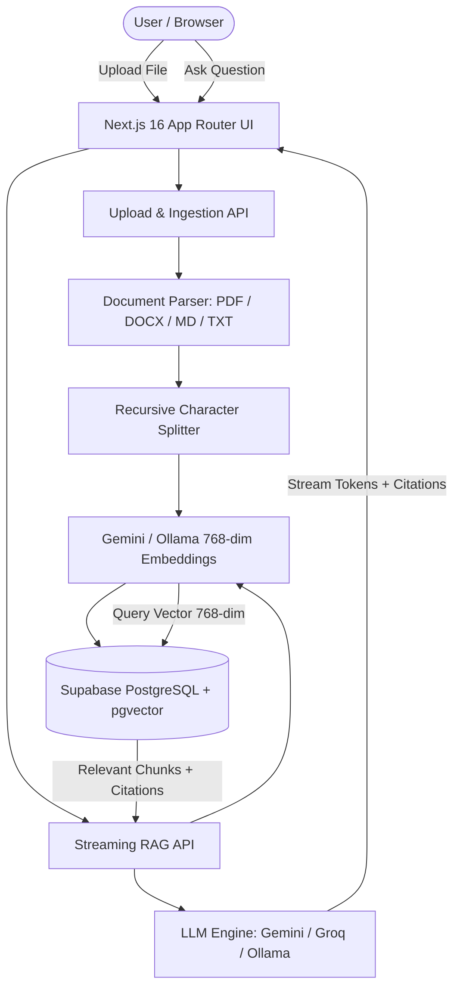

# KnowFlow AI ⚡ Grounded RAG with pgvector & LangChain.js

A production-grade AI SaaS platform that enables teams to upload enterprise documents, create isolated knowledge bases, and ask questions answered by LLMs through Retrieval-Augmented Generation (RAG) with verifiable citations and source grounding.

---

## 🌟 Highlights

- **Multi-Provider AI Engine (LangChain.js Orchestrated)**:
  - **Google Gemini** (`gemini-3.5-flash` + `gemini-embedding-001` with 768-dim embeddings) — high-speed, generous free-tier cloud inference.
  - **Groq LPUs** (`openai/gpt-oss-120b` / `llama-3.3-70b-versatile`) — ultra-low-latency chat generation.
  - **Local Ollama** (`llama3.2` + `nomic-embed-text`) — 100% offline privacy and zero API costs.
- **Enterprise RAG Pipeline**:
  - Vector similarity search powered by **Supabase PostgreSQL & `pgvector`** (`vector(768)`) with HNSW indexing and `match_document_chunks` RPC.
  - Multi-format ingestion: **PDF** (page-aware text extraction), **DOCX** (via Mammoth), **Markdown**, and **Plain Text**.
  - Intelligent chunking (1000 characters with 200-character overlaps) preserving section context and page metadata.
  - Honest grounding: Refuses hallucination when retrieval cosine similarity falls below safety thresholds, using calibrated default thresholds (`0.35`) with an adaptive overview fallback (`0.25`).
- **Modern Streaming UI & Observability**:
  - Server-Sent Events (SSE) streaming tokens in real-time.
  - Interactive source citation cards displaying document name, page number, similarity score, and excerpt.
  - Document-level query filtering and failed document retry capabilities.
  - Message feedback persistence via `POST /api/feedback` (thumbs up / thumbs down).
  - PostgreSQL-backed rate limiting (`30 requests/minute`) with standard `429` status codes and `Retry-After` headers.
  - Real SQL aggregate analytics and usage telemetry logging (`prompt_tokens`, `completion_tokens`, `latency_ms`).
- **Inclusive Accessibility (WCAG 2.2 AA)**:
  - Multi-modal state cues (icons + text + color coding), full keyboard navigation (`Tab`, `Escape`, arrow keys), ARIA live announcements, high-contrast palette, and verified with `axe-core`.
- **Strict Full-Stack Quality**:
  - 100% TypeScript strict mode, clean ESM (`"type": "module"`), self-hosted fonts.
  - Zero mock data or synthetic fallback guarantees.
  - Comprehensive unit and component tests with **Vitest**, **React Testing Library**, and **Playwright**.
  - Production-ready builds verified on **Next.js 16 (Turbopack)**.

---

## 🏗️ Architecture



---

## 🛠️ Technology Stack

| Layer                   | Technology                                                   |
| ----------------------- | ------------------------------------------------------------ |
| **Framework**           | Next.js 16 (App Router, Turbopack, Cache Components)         |
| **Language**            | TypeScript (Strict Mode, ESM `"type": "module"`)             |
| **Styling**             | Tailwind CSS v4, Lucide Icons                                |
| **UI Components**       | Accessible Radix UI Primitives, Sonner (Toasts)              |
| **Forms & Validation**  | React Hook Form, Zod v4                                      |
| **RAG & Orchestration** | LangChain.js (`@langchain/core`, `@langchain/textsplitters`) |
| **Vector Database**     | Supabase PostgreSQL with `pgvector` (`vector(768)`) & RLS    |
| **Document Parsing**    | `pdf-parse`, `mammoth`                                       |
| **Rate Limiting**       | PostgreSQL `rate_limits` table with sliding window grouping  |
| **Testing**             | Vitest, React Testing Library, axe-core, Playwright          |

---

## 🚀 Quickstart Guide

### 1. Clone & Install Dependencies

```bash
git clone https://github.com/your-username/knowflow-ai.git
cd knowflow-ai
npm install
```

### 2. Environment Configuration

Copy the provided example file:

```bash
cp .env.example .env.local
```

Configure your secrets in `.env.local`:

```env
# Supabase Database & Auth (pgvector)
NEXT_PUBLIC_SUPABASE_URL=https://your-project.supabase.co
NEXT_PUBLIC_SUPABASE_ANON_KEY=your_anon_key
SUPABASE_SERVICE_ROLE_KEY=your_service_role_key

# AI Provider Configuration (default: gemini)
AI_PROVIDER=gemini
EMBEDDING_PROVIDER=gemini

# Google Gemini (Free Tier)
GEMINI_API_KEY=your_gemini_api_key
GEMINI_CHAT_MODEL=gemini-3.5-flash
GEMINI_EMBED_MODEL=gemini-embedding-001

# Groq (Optional Free Tier for ultra-fast chat)
GROQ_API_KEY=your_groq_api_key
GROQ_CHAT_MODEL=openai/gpt-oss-120b

# Ollama (Optional Local Offline Inference)
OLLAMA_BASE_URL=http://localhost:11434
OLLAMA_CHAT_MODEL=llama3.2
OLLAMA_EMBED_MODEL=nomic-embed-text
```

### 3. Database Migration

Execute the database migrations in chronological order inside your Supabase SQL Editor:

1. `supabase/migrations/20250101000000_knowflow_init.sql`
2. `supabase/migrations/20260324000000_phase3_schema_security.sql`

This establishes:

- Multi-tenant `workspaces`, `workspace_members`, `documents`, and `document_chunks` tables
- PostgreSQL `pgvector` extension configured for 768-dimensional embeddings
- Hardened `match_document_chunks` stored procedure with `SECURITY INVOKER` and workspace membership verification
- Sliding-window `rate_limits` table
- Row-Level Security (RLS) policies on all tables

### 4. Run Development Server

```bash
npm run dev
```

Open [http://localhost:3000](http://localhost:3000) to access KnowFlow AI.

### 5. Run Automated Tests

```bash
# Run unit, component, and accessibility test suites
npm test

# Run code quality linting
npm run lint

# Run TypeScript static typecheck
npx tsc --noEmit

# Run production build validation
npm run build
```

---

## 📂 Project Structure

```text
knowflow-ai/
├── app/
│   ├── api/
│   │   ├── analytics/                # SQL aggregate telemetry & counts
│   │   ├── chat/                     # Rate-limited SSE streaming RAG endpoint
│   │   ├── conversations/            # Chat thread persistence & message history
│   │   ├── documents/                # Document listing, retry, and deletion
│   │   ├── documents/upload/         # Multi-format parser, chunker & vector indexer
│   │   ├── feedback/                 # Message feedback persistence (thumbs up/down)
│   │   └── workspaces/               # Workspace switcher, rename, members, and deletion
│   ├── analytics/                    # Telemetry analytics dashboard
│   ├── chat/                         # Interactive Q&A interface with source citations
│   ├── dashboard/                    # Overview workspace management & quick actions
│   ├── documents/                    # Document management, search & status filters
│   ├── forgot-password/              # Secure password recovery request
│   ├── reset-password/               # Password update confirmation
│   ├── settings/                     # Workspace roster, provider & pgvector settings
│   ├── privacy/                      # Data governance & privacy policy (draft)
│   ├── terms/                        # Terms of service & AI output disclaimer (draft)
│   ├── layout.tsx                    # Root shell with persistent navigation & self-hosted fonts
│   └── page.tsx                      # Modern product landing page
├── components/
│   ├── analytics/                    # Recharts visual telemetry & activity logs
│   ├── auth/                         # Supabase authentication modal
│   ├── chat/                         # Streaming chat box, citation badges, model selector
│   ├── dashboard/                    # Hero action banner & stat metric cards
│   ├── documents/                    # Upload dropzone, document cards, search & filter toolbar
│   ├── navigation/                   # Accessible sidebar, header & quick switcher
│   └── workspaces/                   # Workspace switcher & team management settings
├── docs/
│   ├── architecture.md               # High-level architecture & design patterns
│   ├── production-lessons.md         # Production incident log & root cause resolutions
│   ├── rag.md                        # RAG pipeline, chunking math & similarity calibration
│   ├── security.md                   # Multi-tenant isolation & Row-Level Security model
│   └── testing.md                    # Vitest, RTL, axe-core & Playwright test strategy
├── lib/
│   ├── ai/                           # Multi-provider LLM & embedding factory
│   ├── auth/                         # Session verification & workspace membership guards
│   ├── rate-limit.ts                 # PostgreSQL-backed sliding window rate limiter
│   └── supabase/                     # Client, server, and service-role Supabase clients
├── services/
│   ├── document-processor.ts         # Page extraction, recursive chunking & pgvector storage
│   └── rag-service.ts                # LangChain retrieval, adaptive thresholding & streaming
├── supabase/
│   └── migrations/                   # SQL migrations & stored procedures
└── tests/
    ├── components/                   # RTL and axe-core accessibility tests
    ├── e2e/                          # Playwright end-to-end tests for 10 core flows
    └── unit/                         # Unit tests (auth guards, rate limiting, embeddings, etc.)
```

---

## 📄 License

MIT License. See [LICENSE](LICENSE) for details.
