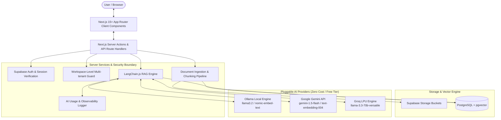

# KnowFlow AI — System Architecture & Design Specification

## 1. System Overview

**KnowFlow AI** ("Turn your knowledge into instant answers") is an enterprise-grade Retrieval-Augmented Generation (RAG) SaaS platform designed for multi-tenant document intelligence, grounded question-answering with verifiable citations, and multi-provider AI execution (Ollama, Gemini, Groq).

---

## 2. Layered Architecture

### A. Presentation Layer (Next.js App Router)
- **Styling**: Tailwind CSS + curated bright color palette (Electric Blue `#2563EB`, Cyan `#06B6D4`, Violet `#7C3AED`, Pink `#EC4899`, Emerald `#10B981`).
- **Primitives**: Radix UI accessible headless components (`@radix-ui/react-dialog`, `@radix-ui/react-dropdown-menu`, `@radix-ui/react-tabs`, `@radix-ui/react-tooltip`).
- **Icons & Data Viz**: Lucide React and Recharts.
- **Forms**: React Hook Form with Zod schema validation.
- **Accessibility**: Semantic HTML5 tags, full keyboard navigation, visible focus rings, ARIA live region orchestration for LLM streaming, WCAG 2.2 AA conformance.

### B. Security & Isolation Layer (Zero-Trust Multi-Tenancy)
- Every request resolves the authenticated user session via Supabase Auth JWT cookies.
- Application-level verification verifies that the user is an authorized member or owner of `workspace_id`.
- PostgreSQL **Row Level Security (RLS)** acts as a defense-in-depth barrier.
- All vector search queries are strictly bounded by `workspace_id` in SQL stored procedures (`match_document_chunks`).

### C. Document Processing Pipeline
1. **Upload**: Client sends multipart file (PDF, DOCX, TXT, MD) up to 10MB.
2. **Sanitization**: File type, size, extension, MIME type validated via server rules.
3. **Storage**: Original document saved in private Supabase Storage bucket (`documents/{workspace_id}/{document_id}`).
4. **Text Extraction**:
   - PDF: `pdf-parse` (open-source text and page layout extraction).
   - DOCX: `mammoth` (HTML/plain-text extraction preserving structure).
   - TXT / Markdown: native UTF-8 streaming parser with header normalization.
5. **Text Normalization**: Stripping control characters, collapsing redundant whitespace, preserving structural paragraphs.
6. **Chunking**: LangChain `RecursiveCharacterTextSplitter` configured for 1000 characters with 200 character overlap, with custom markdown/natural separators.
7. **Embeddings**: Generated in batches using the configured provider (`OllamaEmbeddings` or `GoogleGenerativeAIEmbeddings`).
8. **Vector Persistence**: Saved into `document_chunks` table containing `content`, `metadata` (page number, chunk index, byte offset), and `embedding` vector.

### D. LangChain.js RAG & Streaming Engine
1. Query validation and sanitization (defense against prompt injection).
2. Query embedding generated via selected embedding provider.
3. Top-K semantic similarity retrieval via pgvector `match_document_chunks(query_embedding, match_threshold, match_count, filter_workspace_id)`.
4. Context construction with strict grounding instructions:
   - "Answer ONLY based on the provided context."
   - "If evidence is insufficient, state: 'I couldn't find enough information in your knowledge base to answer that.'"
   - Explicit chunk numbering `[Chunk X]` for verifiable citations.
5. LangChain ChatPromptTemplate + ChatModel runnable pipeline.
6. Output streaming via Web Streams API with incremental token dispatch.
7. Real-time citation mapping: Citations are synthesized strictly from retrieved database chunk metadata (document title, page number, preview snippet), never hallucinated by the model.
8. Persist conversation, message, and citation records upon completion.
